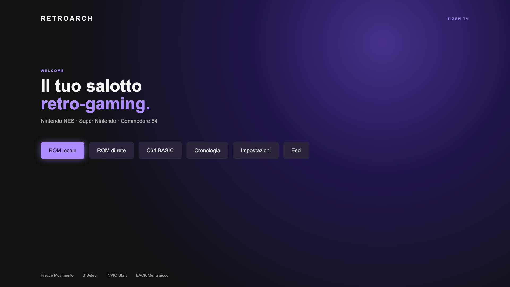
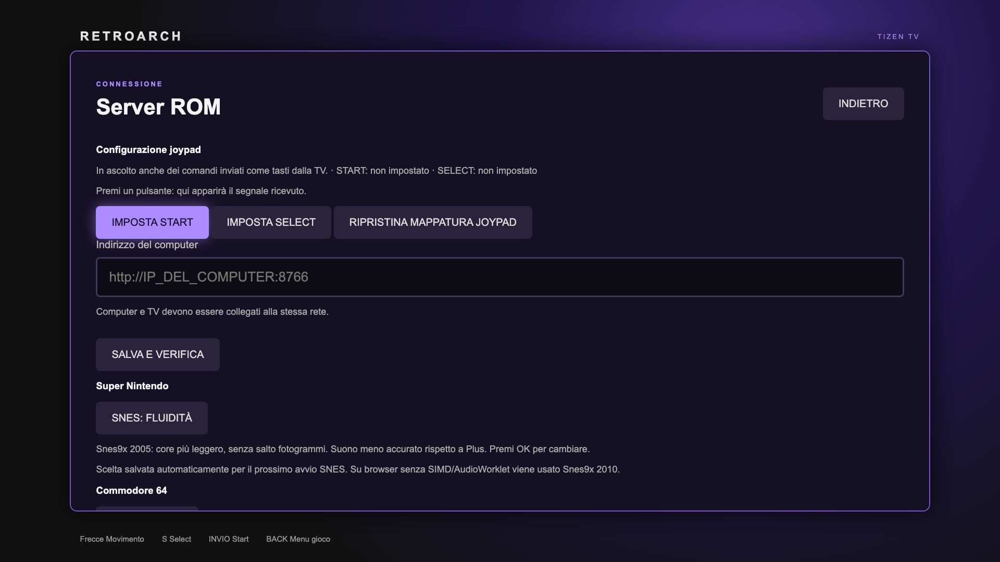

# Tizen RetroArch

[English](README.md) | [Italiano](README.it.md)

Un prototipo di front-end **RetroArch/libretro per Samsung Smart TV Tizen**, realizzato come applicazione web locale con core WebAssembly. Offre una dashboard navigabile con telecomando, tastiera o controller e una libreria di giochi sulla rete domestica.

> Progetto sperimentale, non ufficiale e non affiliato a Samsung o al team RetroArch. La versione di partenza è stata provata su Samsung UE65DU7172; compatibilità, prestazioni e controller variano fra TV e giochi. Non è un port nativo: il codice WebAssembly viene eseguito dal motore web della TV.



## Funzioni

- Nintendo NES con FCEUmm; Super Nintendo con Snes9x 2005/2005 Plus e fallback 2010; Commodore 64 con VICE x64.
- Apertura di file locali e navigazione di cartelle e sottocartelle tramite server ROM sulla rete locale.
- Modalità C64 BASIC, tastiera virtuale e salvataggio/ripristino della sessione nell'archivio dell'app sulla TV.
- AudioWorklet e core ottimizzati quando la TV supporta le funzionalità necessarie; percorso audio di compatibilità negli altri casi.
- Modalità schermo intero, menu in gioco, profili di prestazioni SNES/C64 e configurazione Start/Select del controller.



Gli screenshot mostrano l'interfaccia nell'anteprima desktop; non contengono immagini di giochi commerciali. Nintendo 64 e PlayStation non sono supportati in questa versione.

## Prima di iniziare

Questo repository contiene il front-end, gli script di compilazione e le modifiche ai sorgenti upstream. **Non contiene core WebAssembly precompilati, pacchetti WGT firmati, giochi, certificati o chiavi.** Per installarlo occorre compilare i core e firmare il pacchetto con il proprio certificato Samsung. La guida completa è [Installazione e utilizzo](docs/INSTALLAZIONE.md).

Servono Git, Python 3, `make`, `rsync`, due versioni di Emscripten e Tizen Studio o Tizen Extension con gli strumenti Samsung TV. Gli script di compilazione sono in Bash e sono stati preparati su macOS; su altri sistemi potrebbero richiedere adattamenti. La compilazione scarica sorgenti da progetti di terze parti: leggi prima [Licenze e contenuti](LICENSES.it.md).

```sh
git clone https://github.com/elisir80/tizen-retroarch.git
cd tizen-retroarch
bash tools/fetch-sources.sh

git clone https://github.com/emscripten-core/emsdk.git .emsdk
.emsdk/emsdk install 3.1.46
.emsdk/emsdk activate 3.1.46
git clone https://github.com/emscripten-core/emsdk.git .emsdk-worklet
.emsdk-worklet/emsdk install 4.0.15
.emsdk-worklet/emsdk activate 4.0.15

bash tools/build-compat.sh
bash tools/build-audioworklet.sh all
```

Poi crea un profilo certificato Samsung TV e collega la TV in Developer Mode. Con `tz` disponibile nel `PATH`, genera il WGT con:

```sh
bash tools/package-tv.sh 'NOME_PROFILO_CERTIFICATO'
```

Il file è `build/RetroArch.wgt`. Per collegamento, installazione, avvio, prove e risoluzione dei problemi consulta la [guida dettagliata](docs/INSTALLAZIONE.md). **Non pubblicare il WGT firmato o il certificato personale.**

## Server ROM sulla rete locale

Sul computer, scegli una cartella contenente solo i file che vuoi condividere:

```sh
python3 rom_server.py --folder "$HOME/ROMs" --port 8766
```

Crea prima la cartella se non esiste. Il programma mostra un indirizzo da inserire in **Impostazioni → Indirizzo del computer** sulla TV; premi **Salva e verifica**, poi apri **ROM di rete**. Se il computer usa Wi-Fi ed Ethernet, controlla che l'indirizzo visualizzato corrisponda all'interfaccia raggiungibile dalla TV.

Il server è progettato per reti fidate: ascolta su tutte le interfacce, **non ha autenticazione né cifratura**, e condivide i file di gioco supportati nella cartella scelta e nelle sottocartelle. Non esporre la porta a Internet, non usare una cartella con file privati e fermalo con `Ctrl+C` quando non serve. La TV scarica il gioco prima dell'esecuzione.

## Stato e limitazioni

- Il progetto è stato provato su una TV Samsung; non è una garanzia per altri modelli, firmware, ROM o periferiche.
- I core ricompilati da questo repository sono stati avviati in anteprima desktop per il test NES; il nuovo WGT non è stato ancora installato e verificato su una TV.
- L'audio e la fluidità dipendono dal core e dal gioco. I profili SNES/C64 offrono compromessi diversi.
- Alcuni adattatori USB potrebbero non trasmettere tutti i pulsanti. In quel caso è possibile assegnare Start/Select a pulsanti riconosciuti; un test con DualShock 4 Bluetooth è ancora da confermare.
- La modalità BASIC e i salvataggi dipendono dai dati locali dell'app. Disinstallare l'app può cancellarli.
- Lo scopo è la ricerca e l'uso personale con software homebrew o contenuti per cui si possiedono i diritti necessari. BIOS/firmware e contenuti di terze parti possono avere licenze distinte.

## Verifiche per sviluppatori

```sh
node --check main.js
node --check joypad-input.js
node tools/test-joypad-input.mjs
node tools/test-snes-config.mjs
xmllint --noout config.xml
python3 tools/preview_server.py
```

Apri `http://127.0.0.1:8765/` sullo stesso computer. L'anteprima prova l'interfaccia nel browser desktop; non sostituisce i test su TV, audio e controller fisici. I core funzionano solo dopo la compilazione.

Le modifiche a RetroArch, FCEUmm e VICE sono in [`patches/`](patches/); versioni e URL esatti sono in [`tools/fetch-sources.sh`](tools/fetch-sources.sh). I componenti conservano le loro licenze e condizioni: vedi [LICENSES.it.md](LICENSES.it.md). I dettagli delle verifiche iniziali sono in [docs/VERIFICHE.md](docs/VERIFICHE.md).
