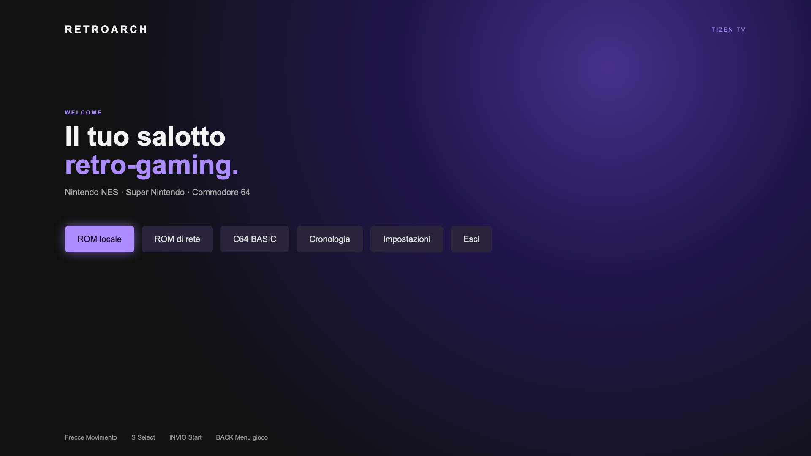
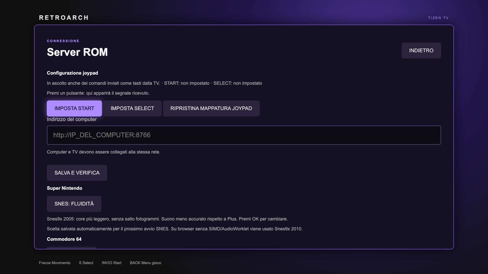

# Tizen RetroArch

[English](README.md) | [Italiano](README.it.md)

An experimental **RetroArch/libretro frontend for Samsung Smart TVs running Tizen**, built as a local web application with WebAssembly cores. It provides a dashboard navigable with a remote, keyboard, or controller, plus a home-network game library.

> This is an unofficial experimental project, not affiliated with Samsung or the RetroArch team. The original development version was tested on a Samsung UE65DU7172; compatibility, performance, and controller behavior vary by TV and game. This is not a native port: the TV's web engine executes the WebAssembly code.



## Features

- Nintendo NES with FCEUmm; Super Nintendo with Snes9x 2005/2005 Plus and a Snes9x 2010 fallback; Commodore 64 with VICE x64.
- Open local files or browse folders and subfolders through a ROM server on the local network.
- C64 BASIC mode, a virtual keyboard, and session save/restore in the TV app's local storage.
- AudioWorklet and optimized cores when the TV supports the required features, with a compatibility audio path otherwise.
- Fullscreen, an in-game menu, SNES/C64 performance profiles, and controller Start/Select configuration.



The screenshots show the interface in the desktop preview and do not contain commercial game imagery. The current application interface and screenshots are in Italian. Nintendo 64 and PlayStation are not supported in this version.

## Before you begin

This repository contains the frontend, build scripts, and modifications to upstream sources. **It does not include precompiled WebAssembly cores, signed WGT packages, games, certificates, or keys.** To install it, build the cores and sign the package with your own Samsung certificate. See the complete [installation and usage guide](docs/INSTALLATION.md).

You need Git, Python 3, `make`, `rsync`, two Emscripten versions, and Tizen Studio or Tizen Extension with Samsung TV tools. The Bash build scripts were prepared on macOS and may need adjustments on other systems. Building downloads third-party sources; first read [Licenses and third-party content](LICENSES.md).

```sh
git clone https://github.com/elisir80/tizen-retroarch.git
cd tizen-retroarch
bash tools/fetch-sources.sh

git clone https://github.com/emscripten-core/emsdk.git .emsdk
.emsdk/emsdk install 3.1.46
.emsdk/emsdk activate 3.1.46
git clone https://github.com/emscripten-core/emsdk.git .emsdk-worklet
.emsdk-worklet/emsdk install 4.0.15
.emsdk-worklet/emsdk activate 4.0.15

bash tools/build-compat.sh
bash tools/build-audioworklet.sh all
```

Then create a Samsung TV certificate profile and connect the TV in Developer Mode. With `tz` available on `PATH`, create the WGT:

```sh
bash tools/package-tv.sh 'YOUR_CERTIFICATE_PROFILE_NAME'
```

The resulting file is `build/RetroArch.wgt`. For connection, installation, launch, testing, and troubleshooting, follow the [detailed guide](docs/INSTALLATION.md). **Do not publish your personally signed WGT or certificate.**

## Local network ROM server

On your computer, choose a folder containing only files you want to share:

```sh
python3 rom_server.py --folder "$HOME/ROMs" --port 8766
```

Create the folder first if necessary. Enter the address printed by the server in the TV app under **Impostazioni → Indirizzo del computer** (Settings → Computer address), select **SALVA E VERIFICA** (Save and verify), then open **ROM di rete** (Network ROMs). If the computer uses both Wi-Fi and Ethernet, make sure the displayed address belongs to the interface reachable from the TV.

The server is intended for trusted networks: it listens on all interfaces, **has no authentication or encryption**, and shares supported game files in the selected folder and its subfolders. Do not expose the port to the Internet or use a folder containing private files. Stop the server with `Ctrl+C` when finished. The TV downloads a game before running it.

## Status and limitations

- The project has been tested on one Samsung TV; this does not guarantee compatibility with other models, firmware, ROMs, or peripherals.
- The cores rebuilt from this repository were used for a desktop NES preview smoke test; the new WGT has not yet been installed or tested on a TV.
- Audio and smoothness depend on the core and game. SNES/C64 profiles provide different trade-offs.
- Some USB adapters may not transmit every button. Start/Select can be assigned to recognized buttons; testing with a Bluetooth DualShock 4 remains outstanding.
- BASIC mode and save states depend on the app's local data. Uninstalling the app can erase them.
- The project is intended for research and personal use with homebrew software or content for which you have the necessary rights. Third-party BIOS, firmware, and content may have separate licenses.

## Developer checks

```sh
node --check main.js
node --check joypad-input.js
node tools/test-joypad-input.mjs
node tools/test-snes-config.mjs
xmllint --noout config.xml
python3 tools/preview_server.py
```

Open `http://127.0.0.1:8765/` on the same computer. The preview tests the interface in a desktop browser; it does not replace testing on a TV with real audio and controllers. Cores are available only after compilation.

RetroArch, FCEUmm, and VICE changes are in [`patches/`](patches/); exact versions and URLs are in [`tools/fetch-sources.sh`](tools/fetch-sources.sh). Components retain their own licenses and conditions: see [LICENSES.md](LICENSES.md). The initial verification record is in [docs/VALIDATION.md](docs/VALIDATION.md).
